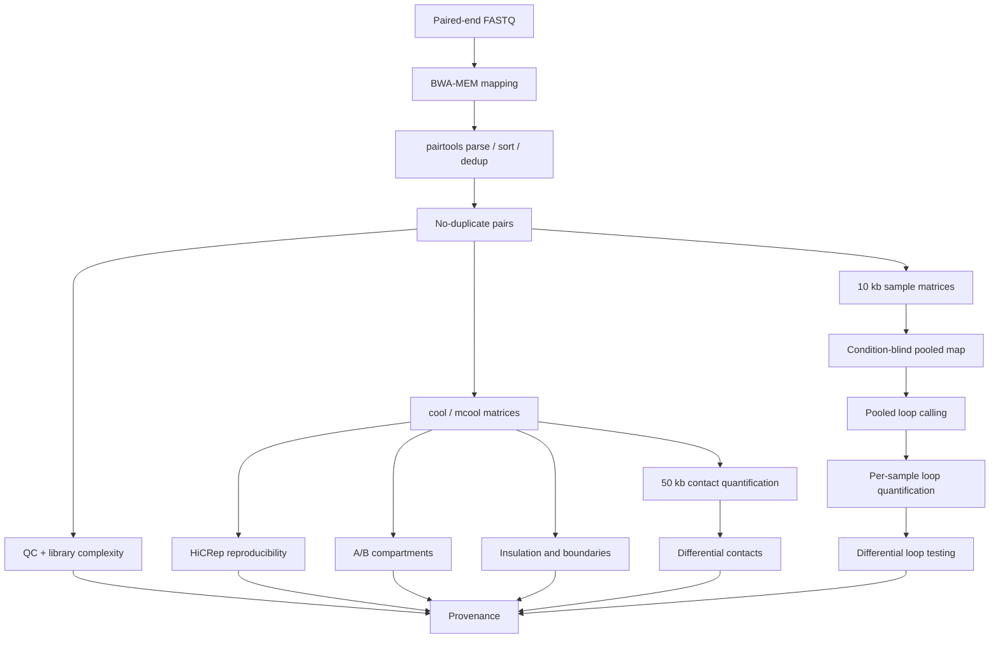

# SnakeMicroC

Reusable Snakemake workflow for **Micro-C processing, quality control and downstream 3D genome analysis**.

SnakeMicroC processes paired-end Micro-C sequencing data from FASTQ files through contact-pair generation, matrix construction, quality control and comparative structural analyses.

## Workflow



## Main analyses

- BWA-MEM mapping of paired-end FASTQ files
- pairtools parsing, sorting and duplicate removal
- mapping and contact-pair quality control
- library-complexity assessment
- cool and mcool contact-matrix generation
- HiCRep sample reproducibility
- A/B compartment analysis
- insulation and boundary analysis
- genome-wide differential contact testing
- condition-blind pooled loop calling
- per-sample loop quantification
- differential loop testing with edgeR
- automatic software and parameter provenance

## Repository structure

```text
SnakeMicroC/
├── Snakefile
├── config/
│   └── config.template.yaml
├── env/
│   ├── processing.yaml
│   ├── downstream.yaml
│   └── r.yaml
├── scripts/
│   ├── build_contact50_counts.py
│   ├── build_loop_counts.py
│   ├── compare_structural_tracks.py
│   ├── differential_contacts50_edgeR.R
│   ├── differential_loops_edgeR.R
│   ├── library_complexity.py
│   ├── plot_contact_maps_multisample.py
│   ├── plot_sample_correlation.py
│   ├── plot_scaling.py
│   ├── prepare_reference.py
│   ├── run_hicrep.py
│   ├── summarize_qc.py
│   ├── write_env_versions.py
│   ├── write_provenance.py
│   └── write_r_versions.R
└── README.md
```

## Conda environments

| Environment | Purpose |
| --- | --- |
| `env/processing.yaml` | BWA, samtools, pairtools and read-pair processing |
| `env/downstream.yaml` | cooler, cooltools, bioframe, HiCRep and Python analyses |
| `env/r.yaml` | edgeR and R-based differential analyses |

## Configuration

Start a new project by copying the template:

```bash
cp /path/to/SnakeMicroC/config/config.template.yaml ./config.yaml
```

The configuration file defines the reference genome, FASTQ paths, sample names, experimental conditions, processing parameters, QC thresholds and downstream analysis settings.

Sample identities and conditions are not hard-coded in the workflow.

## Running the workflow

Run SnakeMicroC from the project workspace:

```bash

snakemake \
  -s /path/to/SnakeMicroC/Snakefile \
  --configfile ./config.yaml \
  --use-conda \
  --conda-frontend conda \
  --cores 30 \
  --rerun-triggers mtime \
  -- \
  all
```

If mamba causes environment-creation issues on your system, use `--conda-frontend conda`.

## Main outputs

```text
results/
├── pairs/
├── qc/
├── mcool/
├── reproducibility/
├── structural/
├── contacts/
├── loops/
└── provenance/
```

## Default downstream analysis strategy

- Primary A/B compartment resolution: **100 kb**
- Insulation and boundaries: **10 kb bins**
- Insulation windows: **200 kb and 500 kb**
- Primary boundary window: **500 kb**
- Differential contacts: **50 kb**
- Primary loop resolution: **10 kb**

Loop candidates are called on a **condition-blind pooled map** and are subsequently quantified in each individual sample before differential testing.

## Provenance

Every complete run records:

```text
results/provenance/
├── resolved_config.yaml
├── software_versions.tsv
└── run_summary.tsv
```

Software versions are collected independently from the processing, downstream and R environments.

## Validation

SnakeMicroC was validated in September 2026 using real Micro-C sequencing data.

The FASTQ-to-pairs workflow was tested directly on independent subsets of real paired-end FASTQ files and successfully generated deduplicated pair files and pairtools statistics.

The downstream workflow was also checked through Snakemake DAG construction for QC, matrix generation, HiCRep, compartments, insulation and boundaries, differential contacts, pooled loop calling and differential loop testing.

## Notes

- Run each experiment from a dedicated project workspace.
- Do not write project-specific results inside the shared SnakeMicroC directory.
- Keep experiment-specific biological integration outside the generic core workflow.
